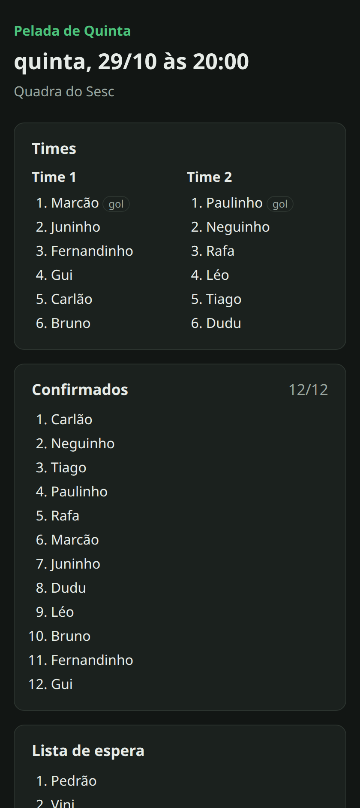

# Pelada Manager

[](https://github.com/Miguelbbezerra/pelada-manager/actions/workflows/ci.yml)

API para organizar pelada: lista de presença com fila de espera, sorteio de times
equilibrado e controle das mensalidades.

Feita com **FastAPI**, **PostgreSQL**, **Redis** e **Docker**.

## O problema

Quem já organizou pelada conhece a rotina. Na segunda alguém manda no grupo
"lista de quinta" e cada um copia a mensagem, coloca o nome e cola de volta.
Duas pessoas colam ao mesmo tempo e uma some da lista. O 13º nome vira "reserva",
mas quando alguém desiste ninguém lembra quem era o próximo. Na hora de tirar os
times, os dois melhores caem juntos. E no fim do mês o organizador abre uma
planilha pra descobrir quem ainda não pagou a quadra.

Cada um desses pontos virou uma regra no sistema:

- **Lista com limite de vagas.** Passou do limite, a pessoa entra na lista de
  espera e sabe em que posição está.
- **Desistência libera a vaga sozinha.** O primeiro da espera é promovido na
  hora. Mensalista tem prioridade sobre avulso na espera.
- **Duas confirmações ao mesmo tempo não estouram o limite.** É o "colaram junto
  e um sumiu" do WhatsApp, resolvido com lock no banco (detalhes abaixo).
- **Sorteio de times equilibrado** pelo nível de cada jogador (1 a 5),
  distribuindo um goleiro por time quando tiver.
- **Mensalidades**: quem pagou cada mês, quem está devendo e o caixa mês a mês.
  Todo mundo do grupo pode ver: caixa de pelada só funciona com transparência.
- **Página pública do jogo** (`/p/<código>`), pra mandar o link no grupo. Tem um
  botão que copia a lista já no formato de mensagem do WhatsApp.

<p align="center"></p>

## Rodando

Precisa só do Docker.

```bash
git clone https://github.com/Miguelbbezerra/pelada-manager.git
cd pelada-manager
docker compose up -d --build
```

A API sobe em http://localhost:8010 e a documentação interativa (Swagger) fica
em http://localhost:8010/docs. As migrations rodam sozinhas antes da API subir
(serviço `migrate` no compose).

Pra ter dados de exemplo (14 jogadores, um jogo, times sorteados e algumas
mensalidades pagas):

```bash
uv run python scripts/demo.py
```

```
  Carlão       confirmado
  ...
  Gui          confirmado
  Pedrão       espera #1
  Vini         espera #2

Time 1 (nível 19): Marcão, Juninho, Fernandinho, Gui, Carlão, Bruno
Time 2 (nível 19): Paulinho, Neguinho, Rafa, Léo, Tiago, Dudu

Mensalidade de 2026-10 pendente: Bruno, Fernandinho, Gui, Léo

Página do jogo: http://localhost:8010/p/Ekz9MQi7t2U
```

Os valores padrão do `compose.yaml` servem só pra desenvolvimento. Pra qualquer
outra coisa, copie o `.env.example` para `.env` e troque o `JWT_SECRET`. Com
`ENVIRONMENT=prod` a API se recusa a subir com o segredo padrão.

## Usando a API

Fluxo básico pelo Swagger ou com `curl`:

```bash
# conta + token
curl -X POST localhost:8010/auth/register -H 'Content-Type: application/json' \
  -d '{"name": "Carlão", "email": "carlao@example.com", "password": "senha-forte"}'
TOKEN=$(curl -s -X POST localhost:8010/auth/token \
  -d 'username=carlao@example.com&password=senha-forte' | jq -r .access_token)

# grupo (quem cria vira admin) e jogo
curl -X POST localhost:8010/groups -H "Authorization: Bearer $TOKEN" \
  -H 'Content-Type: application/json' \
  -d '{"name": "Pelada de Quinta", "max_players": 12, "monthly_fee_cents": 8000}'
curl -X POST localhost:8010/groups/1/matches -H "Authorization: Bearer $TOKEN" \
  -H 'Content-Type: application/json' -d '{"starts_at": "2026-11-05T20:00:00-03:00"}'

# confirmar presença
curl -X PUT localhost:8010/matches/1/attendance -H "Authorization: Bearer $TOKEN"
```

Os outros jogadores entram pelo código de convite do grupo
(`POST /groups/join`), que só o admin enxerga.

| | Endpoint | Quem pode |
|---|---|---|
| **Conta** | `POST /auth/register`, `POST /auth/token`, `GET /users/me` | todos |
| **Grupos** | `POST /groups`, `GET /groups`, `POST /groups/join` | logado |
| | `GET /groups/{id}`, `GET /groups/{id}/members` | membro |
| | `PATCH /groups/{id}`, `POST /groups/{id}/invite-code`, `PATCH /groups/{id}/members/{user}` | admin |
| | `DELETE /groups/{id}/members/{user}` | admin, ou o próprio jogador pra sair |
| **Jogos** | `POST /groups/{id}/matches`, `PATCH /matches/{id}` | admin |
| | `GET /groups/{id}/matches`, `GET /matches/{id}` | membro |
| | `PUT /matches/{id}/attendance` (confirma), `DELETE` (desiste) | membro |
| | `POST /matches/{id}/teams` (sorteia), `GET` (vê) | admin / membro |
| **Financeiro** | `POST /groups/{id}/payments`, `DELETE .../payments/{id}` | admin |
| | `GET /groups/{id}/payments?month=2026-10`, `/dues`, `/cashflow?year=`, `/ranking` | membro |
| **Público** | `GET /p/{código}`, `GET /health` | qualquer um |

## Decisões que valem explicar

### Duas pessoas, uma vaga

O jeito ingênuo de confirmar presença é contar os confirmados e inserir. Com duas
requisições chegando juntas, as duas contam 11 de 12 e as duas entram. Por isso
o `confirm` começa com `SELECT ... FOR UPDATE` na linha do jogo, e a segunda
transação espera a primeira terminar.

`tests/test_concurrency.py` testa isso com duas threads, cada uma com sua conexão,
sincronizadas por uma `Barrier`. Pra ter certeza de que o teste testa alguma coisa,
rodei sem o lock: falhou 10 de 10 vezes. Com o lock, passou 10 de 10.

No pagamento a proteção é outra: uma `UNIQUE (group_id, user_id, reference_month)`.
Se dois admins registrarem o mesmo pagamento, o banco recusa o segundo e a API
devolve 409.

### Sorteio de times

Dividir jogadores em dois times com somas de nível iguais é o problema da
partição, que é NP-difícil. Pra 20 pessoas daria até pra testar todas as
combinações, mas não precisa: o algoritmo guloso (do melhor pro pior, sempre pro
time mais fraco entre os que têm menos gente) deixa a diferença entre os times
menor ou igual ao nível do melhor jogador. Simulei 10 mil sorteios com 10 a 22
jogadores de nível aleatório: em 89% deles a diferença ficou em 0 ou 1, e nenhum
passou de 4. Antes de ordenar, os jogadores de mesmo nível são embaralhados,
senão o sorteio sairia igual toda semana.

O código está em [`app/domain/teams.py`](app/domain/teams.py). É Python puro, sem
banco, e por isso tem testes unitários próprios, incluindo 30 sorteios com
semente aleatória checando esse limite.

### Lista de espera com prioridade

A ordem da espera sai direto do `ORDER BY`:

```sql
ORDER BY coalesce(memberships.is_monthly, false) DESC, attendances.responded_at
```

Quem desiste não tem a linha apagada (status vira `declined`). Se a pessoa voltar,
o `responded_at` é atualizado e ela vai pro fim da fila.

### Relatório de mensalidades

É um `LEFT JOIN`: todos os mensalistas aparecem, e quem não pagou vem com o
pagamento `NULL`. Os devedores aparecem primeiro. Este é o SQL que o
SQLAlchemy gera:

```sql
SELECT users.id, users.name, payments.amount_cents, payments.paid_at
FROM users
JOIN memberships ON memberships.user_id = users.id
LEFT OUTER JOIN payments ON payments.user_id = users.id
    AND payments.group_id = 1 AND payments.reference_month = '2026-10-01'
WHERE memberships.group_id = 1 AND memberships.is_monthly IS true
ORDER BY payments.paid_at IS NOT NULL, users.name
```

A condição do mês fica no `ON`, e não no `WHERE`. No `WHERE`, ela transformaria o
`LEFT JOIN` num `INNER JOIN` e os devedores sumiriam do relatório.

### Outras escolhas

- **404 em vez de 403 pra quem não é do grupo.** Quem não participa nem fica
  sabendo que o grupo existe. O 403 fica pra quem é membro mas não é admin.
- **Rate limit do login no Redis**: 5 tentativas por minuto por e-mail. Se o Redis
  cair, o login continua funcionando sem limite (*fail open*). Preferi isso a
  derrubar o login de todo mundo.
- **Senha com Argon2** (via `pwdlib`) e JWT com `PyJWT`. O `passlib`, que aparece
  em muito tutorial, está sem manutenção.
- **Camadas simples:** rotas (HTTP) → services (regras, transações) →
  models (SQLAlchemy). Não criei repositórios em cima do SQLAlchemy porque a
  `Session` já faz esse papel, e uma camada a mais aqui só repetiria código.
- **Sem `async`.** O driver é síncrono (psycopg 3), e o FastAPI roda rotas `def` num
  threadpool. Para o volume de uma pelada, async só traria complexidade.

Modelagem completa, índices e o diagrama ER estão em
[docs/modelagem.md](docs/modelagem.md).

## Testes

```bash
docker compose up -d db   # os testes usam um banco pelada_test no mesmo Postgres
uv sync
uv run pytest --cov
```

São 120 testes, com cobertura de ~99%, e rodam em uns 15 segundos.

- Os testes de API usam **Postgres de verdade**, não SQLite. `FOR UPDATE`,
  `CHECK` e `EXTRACT` se comportam diferente no SQLite, e testar num banco
  diferente do de produção esconde bugs.
- O schema do banco de teste é criado **rodando as migrations**, não com
  `create_all()`. Assim uma migration quebrada derruba o CI.
- Cada teste roda dentro de uma transação que é desfeita no final, então os
  testes não interferem uns nos outros.
- Redis nos testes é o `fakeredis`. O Argon2 dos testes usa custo mínimo,
  senão a suíte levava 60 segundos.

```bash
make lint   # ruff + mypy --strict
```

O CI (GitHub Actions) roda lint, mypy, a suíte com um Postgres de serviço, o
build da imagem e sobe a stack inteira com `docker compose up --wait` pra checar
o healthcheck.

## Docker

- **`Dockerfile` multi-stage.** As dependências são instaladas com `uv` num
  estágio de build, e a imagem final leva só o venv e o código. Ela roda com
  usuário sem root e tem uns 225 MB.
- **`compose.yaml`** tem `api`, `migrate`, `db` (Postgres 17) e `cache` (Redis).
  A `api` só sobe depois que o `migrate` termina com sucesso e o Redis fica
  saudável.
- **`compose.override.yaml`** é carregado automaticamente em desenvolvimento.
  Liga o `--reload` e o `docker compose watch`. Para rodar como em produção:
  `docker compose -f compose.yaml up`.
- As portas ficam presas no `127.0.0.1`. O Redis nem é exposto pra fora da rede
  do compose.

## Estrutura

```
app/
├── api/routes/     # endpoints (só HTTP: valida entrada, chama service, monta resposta)
├── services/       # regras de negócio e transações
├── domain/         # lógica pura, sem banco (sorteio de times)
├── models/         # SQLAlchemy
├── schemas/        # Pydantic (entrada/saída da API)
├── core/           # config, banco, segurança, redis, rate limit
└── templates/      # página pública do jogo
alembic/            # migrations
tests/
├── unit/           # sem banco
├── api/            # endpoint por endpoint, com Postgres
└── test_concurrency.py
```

## O que ainda falta

- **Deploy.** A imagem já está pronta pra rodar num Render, Fly.io ou ECS, mas
  ainda não publiquei em nenhum.
- **Lembrete automático no WhatsApp** pra quem não confirmou (API do WhatsApp
  Business ou um bot).
- **Refresh token.** Hoje o access token dura 7 dias, o que funciona pra um app
  de pelada mas não pra algo sensível.
- **Paginação** no histórico de jogos e nos pagamentos.
- **Pagamento avulso por jogo**, pra quem não é mensalista.

## Licença

MIT
