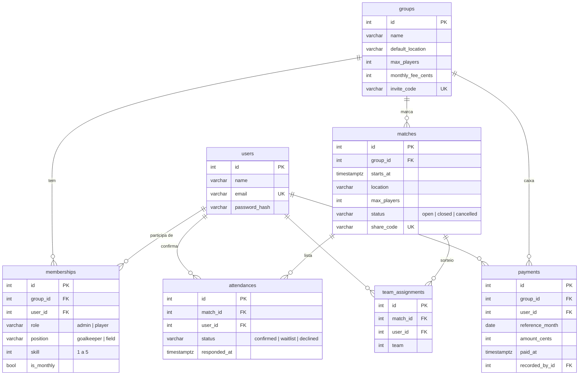

# Modelagem do banco



## Por que assim

**`memberships` e não uma coluna `group_id` em `users`.** A mesma pessoa pode jogar
na pelada de quinta e no society de sábado, com nível e papel diferentes em cada
grupo. Nível, posição e se é mensalista são atributos da participação no grupo,
não da pessoa.

**`attendances` guarda quem desistiu (`declined`) em vez de apagar a linha.** Dá
pra saber quem furou em cima da hora, e a `UNIQUE (match_id, user_id)` continua
valendo: quem volta reaproveita a mesma linha, com `responded_at` atualizado, e
por isso vai pro fim da fila.

**Status como `VARCHAR` + `CHECK`, não `ENUM` do Postgres.** Adicionar um valor
num enum nativo exige `ALTER TYPE`, que não roda dentro de transação em versões
antigas e dá trabalho em migração. Com `CHECK` é só trocar a constraint.

**Dinheiro em centavos (`INTEGER`).** `FLOAT` não representa 0,10 exatamente e
`NUMERIC` seria exagero pra mensalidade de pelada.

**`reference_month` é uma `DATE` sempre no dia 1º** (tem `CHECK` pra isso). Assim
`GROUP BY reference_month` já agrupa por mês sem `date_trunc`, e a
`UNIQUE (group_id, user_id, reference_month)` impede pagar o mesmo mês duas vezes,
mesmo com dois admins registrando ao mesmo tempo.

## Índices

| Índice | Pra quê |
|---|---|
| `attendances (match_id, status, responded_at)` | montar a lista de confirmados e a de espera já na ordem |
| `matches (group_id, starts_at)` | "próximos jogos do grupo" |
| `memberships (user_id)` | "meus grupos" (a unique `(group_id, user_id)` não serve pra buscar só por `user_id`) |
| `UNIQUE` em `email`, `invite_code`, `share_code` | buscas diretas + garantia de unicidade |

## Concorrência na confirmação

Duas pessoas confirmando a última vaga ao mesmo tempo:

```
T1: SELECT count(*) ... status = 'confirmed'   -> 11 (limite 12)
T2: SELECT count(*) ... status = 'confirmed'   -> 11
T1: INSERT ... 'confirmed'
T2: INSERT ... 'confirmed'                     -> 13 confirmados
```

O `confirm` começa com `SELECT ... FROM matches WHERE id = :id FOR UPDATE`. A
segunda transação espera a primeira terminar e só então conta os confirmados.
O lock é só na linha daquele jogo, então confirmações em jogos diferentes não
esperam umas pelas outras. O teste em `tests/test_concurrency.py` reproduz o
cenário com duas threads: sem o `FOR UPDATE` falha em 10 de 10 execuções.
